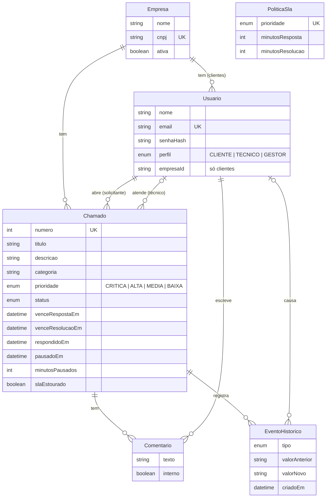
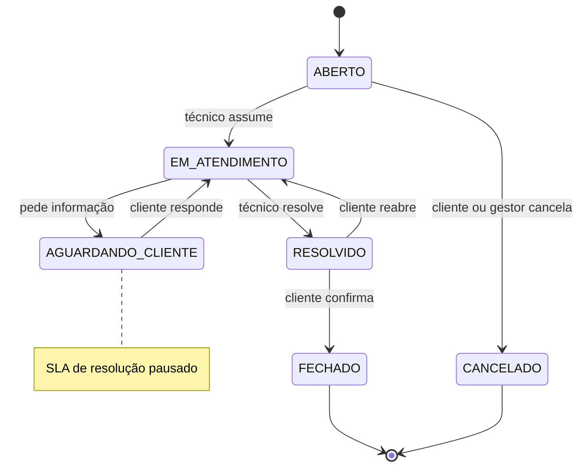

# Helpdesk com SLA

[](https://github.com/Pedrovizkyh/helpdesk-sla/actions/workflows/ci.yml)

**🌐 Site:** `https://SEU-FRONT.vercel.app` &nbsp;·&nbsp; **⚙️ API:** `https://SEU-SERVICO.onrender.com` &nbsp;·&nbsp; **📖 Swagger:** `https://SEU-SERVICO.onrender.com/docs`

<!-- TODO: trocar os três links acima pelas URLs reais depois do deploy -->

Empresas clientes abrem chamados, técnicos atendem e o sistema controla o prazo (SLA) de cada um: calcula os prazos na abertura, pausa o relógio enquanto aguarda o cliente, marca o que estourou num job agendado e avisa por e-mail através de uma fila.

<!-- TODO: GIF do fluxo cliente → técnico → gestor -->
<p align="center"><em>[ espaço para o GIF do fluxo cliente → técnico → gestor ]</em></p>

| Lista de chamados | Detalhe com linha do tempo | Painel do gestor |
| --- | --- | --- |
| <!-- TODO: print --> _[ print ]_ | <!-- TODO: print --> _[ print ]_ | <!-- TODO: print --> _[ print ]_ |

## Logins de demonstração

Senha de todos: **`demo1234`** (a tela de login tem atalhos de um clique).

| Perfil | E-mail | O que dá para fazer |
| --- | --- | --- |
| Gestor | `gestor@helpdesk.test` | Vê todos os chamados, atribui técnicos, edita políticas de SLA, vê métricas |
| Técnico | `tecnico@helpdesk.test` | Atende os chamados atribuídos e a fila sem dono, comenta, cria notas internas, muda status |
| Cliente | `cliente@acme.test` | Abre e acompanha chamados da Acme Logística, responde, fecha ou reabre |

Também existem `tecnico2@helpdesk.test`, `diego@acme.test` e `cliente@nimbus.test` (outra empresa, útil para ver o isolamento).

## Stack

| Camada | Tecnologia |
| --- | --- |
| Backend | NestJS 12, Prisma 7 (adapter `pg`), class-validator, Passport JWT, bcrypt |
| Banco | PostgreSQL 17 |
| Filas e jobs | BullMQ + Redis (`@nestjs/bullmq`), `@nestjs/schedule` |
| E-mail | Nodemailer + Mailpit (caixa falsa local) |
| Logs | Pino (`nestjs-pino`) em JSON, com `chamadoId` nos eventos |
| Testes | Jest (unitários) e Supertest (e2e) com banco de teste no Docker |
| Documentação | Swagger em `/docs` |
| CI | GitHub Actions com Postgres e Redis como services |
| Frontend | React 19 + Vite, Tailwind 4, shadcn/ui, TanStack Query, Recharts, Lucide |
| Deploy | Render (API + worker), Neon (Postgres), Upstash (Redis), Vercel (front) |

```
helpdesk-sla/
├── api/
│   ├── prisma/            # schema, migrations, seed
│   ├── src/
│   │   ├── auth/          # login, JWT, guards e decorators
│   │   ├── empresas/
│   │   ├── usuarios/
│   │   ├── chamados/      # chamados, comentários, histórico, transições
│   │   ├── sla/           # cálculo, políticas e job de verificação
│   │   ├── notificacoes/  # produtor e worker da fila de e-mail
│   │   └── metricas/
│   └── test/              # testes e2e
├── web/                   # React + Vite
├── docker-compose.yml     # Postgres, Redis, Mailpit
├── render.yaml            # blueprint do Render
├── DEPLOY.md              # passo a passo do deploy
└── .github/workflows/ci.yml
```

## Como rodar localmente

Requisitos: Node 24+ e Docker (ou Podman com `podman compose`).

```bash
# 1. Infra: Postgres (5433), Redis (6379) e Mailpit (SMTP 1025, painel 8025)
docker compose up -d

# 2. API
cd api
cp .env.example .env          # troque o JWT_SECRET: openssl rand -hex 32
npm install                   # também gera o Prisma Client
npx prisma migrate dev        # cria as tabelas
npm run seed                  # 2 empresas, 6 usuários, 10 chamados
npm run start:dev             # http://localhost:3000  ·  Swagger em /docs

# 3. Front (outro terminal)
cd web
cp .env.example .env
npm install
npm run dev                   # http://localhost:5173
```

Os e-mails enviados aparecem no Mailpit: <http://localhost:8025>.

### Testes

```bash
cd api
npm run lint
npm test            # unitários: guard de perfis, transições, cálculo do SLA, métricas
npm run test:e2e    # e2e no banco helpdesk_test (criado pelo docker compose)
```

Os e2e usam um relógio falso para "avançar o tempo" e conferir pausa, estouro e recálculo de prazos.

### Worker no mesmo processo

Duas variáveis decidem o que o processo da API carrega:

| Variável | Efeito |
| --- | --- |
| `RUN_WORKER=true` | registra o worker que consome a fila `emails` |
| `RUN_SCHEDULER=true` | liga o `@Cron` que verifica o SLA a cada 5 minutos |

No plano gratuito do Render não existe *background worker*, então os dois rodam junto com a API. Num plano pago, basta subir o mesmo código duas vezes: uma com `RUN_WORKER=false` (API) e outra com `RUN_WORKER=true` (worker). Detalhes em [DEPLOY.md](DEPLOY.md).

## Modelagem



`PoliticaSla` não tem chave estrangeira com `Chamado`: ela só é lida na abertura para calcular os prazos, que ficam gravados no chamado. `Usuario` se liga a `Chamado` duas vezes, com as relações nomeadas `ChamadoSolicitante` e `ChamadoTecnico`.

## Ciclo de status



Qualquer transição fora das setas recebe **422**. As transições ficam num mapa único (`api/src/chamados/transicoes.ts`), que diz também quais perfis podem fazer cada uma (perfil errado recebe **403**).

## Regras de SLA

| Prioridade | 1ª resposta | Resolução |
| --- | --- | --- |
| Crítica | 30 min | 8 h |
| Alta | 2 h | 24 h |
| Média | 4 h | 48 h |
| Baixa | 8 h | 72 h |

- Prazos calculados na abertura e salvos no chamado (`venceRespostaEm`, `venceResolucaoEm`).
- A primeira resposta é o primeiro comentário **público** de quem atende (técnico ou gestor). Nota interna não conta.
- Em **Aguardando cliente**, o prazo de resolução pausa. Ao voltar, é empurrado pelo tempo parado (`minutosPausados` acumula).
- Quando o cliente comenta num chamado em Aguardando cliente, o atendimento é retomado sozinho.
- Mudou a prioridade: os prazos são recalculados **a partir da abertura**, somando o tempo já pausado.
- Um job (`@Cron` a cada 5 min) marca `slaEstourado`, grava `SLA_ESTOURADO` no histórico e enfileira um e-mail para os gestores. Resposta atrasada e resolução atrasada também são marcadas na hora da ação.

## Permissões

| Ação | Cliente | Técnico | Gestor |
| --- | --- | --- | --- |
| Abrir chamado | ✅ | — | ✅ |
| Ver chamados | só da sua empresa | atribuídos + fila sem dono | todos |
| Comentário público | ✅ | ✅ | ✅ |
| Nota interna | — | ✅ | ✅ |
| Assumir chamado da fila | — | ✅ | ✅ |
| Atribuir a outro técnico | — | — | ✅ |
| Mudar status | fechar, reabrir, responder, cancelar | ✅ (exceto cancelar e fechar) | ✅ |
| Configurar SLA e ver métricas | — | — | ✅ |

## Decisões técnicas

### Por que filas para o e-mail?

Mandar e-mail dentro da requisição deixa a API refém do servidor SMTP: se ele demora, o usuário espera; se ele cai, a ação falha ou o e-mail se perde. Com o BullMQ, a requisição só **enfileira** um job no Redis (milissegundos) e responde. O **worker** consome a fila em paralelo e, se o envio falhar, tenta de novo: **3 tentativas com espera exponencial** (10 s, 20 s, 40 s). Os jobs ficam guardados no Redis, então um deploy no meio do envio não perde e-mail. Se nem enfileirar der certo (Redis fora), a falha vai para o log e a ação do usuário não quebra.

### Por que o SLA é gravado no chamado?

Os prazos são calculados **uma vez, na abertura**, e salvos no próprio chamado. A `PoliticaSla` não tem chave estrangeira com ele. Assim:

- mudar a política vale para os próximos chamados e **não reescreve o passado** (o que foi prometido ao cliente continua valendo);
- o job e as métricas fazem consultas simples com índice (`venceResolucaoEm < agora`) em vez de recalcular tudo;
- a pausa é auditável: `pausadoEm` marca o início e `minutosPausados` acumula o total, o que permite recalcular a partir da abertura quando a prioridade muda.

Todo cálculo de data fica em funções puras (`api/src/sla/calculo-sla.ts`) e o "agora" vem de um provider injetável (`Relogio`). Nos testes, um relógio falso avança o tempo, sem nenhum `new Date()` solto nos services.

### Por que o RBAC tem duas camadas?

1. **Na rota:** um `JwtAuthGuard` global protege tudo por padrão (`@Public()` libera exceções, como o login). O `PerfisGuard` lê o decorator `@Perfis('GESTOR', ...)` e barra o perfil errado com 403. O `@UsuarioAtual()` entrega o usuário do token ao controller.
2. **Na query:** "cliente só vê a própria empresa" e "técnico só vê os seus e a fila" não ficam só na rota; estão em `escopoChamados()`, aplicado em **toda** consulta de chamado. Um chamado fora do escopo nem é encontrado (404, sem revelar que existe). Do mesmo jeito, o filtro de notas internas é aplicado na query para o cliente, então nenhum endpoint consegue devolvê-las por engano.

A rota diz *quem pode chamar*; o service diz *o que cada um pode ver*. Esquecer um `@Perfis()` numa rota nova não vaza dados de outra empresa.

### Outras escolhas

- **Logs JSON com Pino:** cada evento importante (`chamado aberto`, `status alterado`, `SLA estourado`, `e-mail enviado`) carrega `chamadoId`, o que facilita filtrar a história de um chamado no agregador de logs.
- **Variáveis de ambiente validadas com zod na subida:** a API nem inicia com configuração inválida; em produção ela recusa e-mail ligado sem `EMAIL_REDIRECT_TO`.
- **Trava otimista nas transições:** a mudança de status grava com `where status = <status lido>`. Duas pessoas mudando ao mesmo tempo recebem 409 em vez de corromper o ciclo.
- **Verificação idempotente:** `marcarEstourado` usa `updateMany where slaEstourado = false`, então o job pode rodar em paralelo ou repetir sem duplicar evento nem e-mail.

## Deploy

Passo a passo completo (Neon, Upstash, Render e Vercel), seed em produção e configuração de e-mail em [DEPLOY.md](DEPLOY.md).
